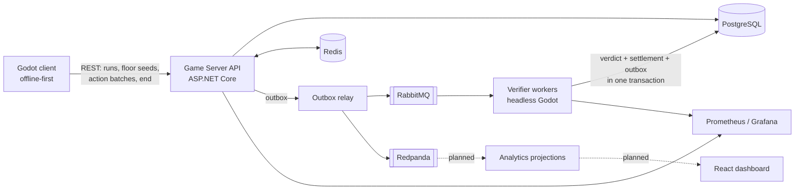

# Turn-Based RPG Distributed System Demo

> **Status: work in progress.** The game is playable and the core backend workflow (server-issued seeds, ordered
> action logs, replay verification, exactly-once rewards) works end to end. Analytics, the live dashboard and load
> testing are still to come. See [Progress](#progress) below.

A roguelike with Isaac-style floors and items and Honkai: Star Rail-style turn-based combat, built in Godot 4.7 on
GodotGAS, backed by a distributed .NET 10 system that verifies, settles and observes everything the player does.

The game plays **offline-first**. Every battle and every run is treated as a versioned distributed workflow:

- the server issues each floor's seed at the stairs (HMAC), so the client can only play the floor it was given;
- the client uploads its choices as an **ordered, idempotent command log** in batches;
- headless Godot workers **replay** each segment of the log and accept or reject it (a mismatch is a verdict, code 2002);
- rewards leave the run **exactly once**, only after verification, in the same transaction as their events;
- events reach the event log only through a **transactional outbox**;
- everything is measured and traced end to end.

The game is both the frontend and the traffic generator for the backend.

## Goals

1. **A real, data-driven game.** Every character, enemy, item, room, event and floor is content (Godot resources on
   GodotGAS abilities, effects and tags); new content needs no code. Combat is deterministic and replayable.
2. **Server authority without a live connection.** Seeds come from the server, the client plays offline, and the server
   verifies by replaying the same game code (one combat implementation, never re-written on the server).
3. **Correct under failure.** Duplicate requests, killed workers, a down event log or a flushed cache must not lose or
   double anything. Each failure scenario has a spec and an automated test.
4. **An account economy.** Gems from verified boss clears and challenges; a Hearthstone-style card collection (packs,
   pity, dust, craft) that decides which characters and items a run can use.
5. **Player analytics.** Every action is logged and projected into analytics tables: most played characters and
   parties, most used moves, items picked up, event decisions, packs and dust flows.
6. **Observability and a live dashboard.** Metrics, traces and Grafana dashboards; a React dashboard with live
   players online, battles in progress, verdicts and analytics.
7. **Load and chaos.** Locust load profiles and scripted chaos runs that show backpressure and recovery in Grafana.

## Tech stack

| Area | Technology |
|---|---|
| Game client | Godot 4.7.2 (.NET), GDScript, GodotGAS 1.1.2 (gameplay ability system), C# bridge |
| Backend services | .NET 10, ASP.NET Core 10 (REST, JWT bearer auth), .NET Worker services |
| Verification | Headless Godot workers (also as a Linux Docker image) consuming jobs from RabbitMQ |
| Database | PostgreSQL 16 (source of truth: runs, action logs, verdicts, ledgers, outbox) |
| Cache / coordination | Redis 7 (cache-aside with Postgres fallback, presence, Lua token-bucket rate limiting) |
| Work queues | RabbitMQ 4 (acks, retry tiers, dead-letter queues) |
| Event log | Redpanda (Kafka API, Confluent.Kafka idempotent producer) |
| Observability | OpenTelemetry .NET, Prometheus, Grafana |
| Testing | Microsoft.Testing.Platform, Testcontainers, an in-house GDScript test runner, end-to-end scripts driving the real game headless |
| Infrastructure | Docker Compose |
| Planned | React + TypeScript dashboard, SignalR, Locust |

## Architecture



## Progress

Measured against the goals above, not against internal slices. Percentages are rough estimates.

| Goal | Status | Progress |
|---|---|---|
| 1. Data-driven game | Playable ten-floor run (The Descent) with branching routes, 11 classes, 30+ enemies and bosses, 100+ items, gear, keys and chests, statuses and boss phases, auto battle, an FF7-style UI, a VFX framework with a full effects pass, Windows exports. Still to do: card screens, card balance, unique events, polish and balance tuning. | ~80% |
| 2. Server authority | Done: HMAC floor seeds, JWT auth, ordered idempotent action batches with checkpoints, local saves and resume, stairs and win gates, step-by-step run verification by headless Godot with rollback. Still to do: routing jobs by ruleset version. | ~90% |
| 3. Correct under failure | 5 of the 7 acceptance scenarios pass automated end-to-end tests (duplicate request, worker killed mid-job, Redpanda down, Redis flushed, tampered log). Still to do: ruleset change during an open battle, load spike with recovery; data retention. | ~70% |
| 4. Account economy | Server side done: gem ledger with pending/released/voided rewards, versioned reward rules, weekly challenges, card catalog, packs with pity, dust and craft, the run's item pool as a verified input. Still to do: the card screens and the economy numbers. | ~70% |
| 5. Player analytics | Domain events already flow through the outbox to Redpanda. The analytics consumers, tables and read API are not built yet. | ~10% |
| 6. Observability and dashboard | Prometheus metrics on every service, OpenTelemetry traces through the outbox, provisioned Grafana dashboards for verification and settlement. Still to do: the full trace and dashboard pass, the React dashboard and SignalR push. | ~30% |
| 7. Load and chaos | Not started. | 0% |

**Overall: roughly 60% of the way to the project's goals.** The hardest part, correct verified runs and rewards, is
in place; what remains is mostly the read side (analytics, dashboards) and the demonstration under load.

Test suites today: about 560 .NET tests (many against real Postgres, Redis, RabbitMQ and Redpanda via Testcontainers),
about 760 Godot tests, and a set of end-to-end scenarios that run the real game headless against the real server and
workers. The detailed build order is in [`specs/roadmap.md`](specs/roadmap.md).

## Repository layout

| Path | What it is |
|---|---|
| `client-godot/` | The Godot game: combat kernel (`combat/`), run layer and UI (`game/`), content (`content/`), presentation, tests |
| `src/Rpg.Contracts/` | Wire contracts only (request/response records, event schemas); no game logic |
| `src/Rpg.Client/` | Typed HTTP client used by the game |
| `src/Rpg.GameServerApi/` | REST API, migrations, outbox relay, caches, rate limiting |
| `src/Rpg.VerifierWorker/` | Verification worker hosting headless Godot |
| `src/Rpg.Economy/` | Rewards, challenges, wallet ledger, cards |
| `src/Rpg.Verification/` | Messaging and outbox code shared by the API and the worker |
| `tests/` | .NET test projects |
| `infra/` | Docker Compose for Postgres, Redis, RabbitMQ, Redpanda, Prometheus, Grafana and the verifier |
| `specs/` | Specifications (spec-driven development: every feature has a spec before code) and the roadmap |
| `tools/` | Test runners, exports, the local dev stack and end-to-end scripts |

## Getting started

Requirements: .NET SDK 10.0.402, Godot 4.7.2 .NET, Docker, Git Bash (on Windows).

```sh
dotnet build && dotnet test                  # build and test the .NET side

cd infra
cp .env.example .env                         # then edit
docker compose up -d                         # Postgres, Redis, RabbitMQ, Redpanda
docker compose --profile observability up -d # + Prometheus (9090) and Grafana (3000)
```

The server needs two development secrets (see `infra/.env.example`):

```sh
cd src/Rpg.GameServerApi
dotnet user-secrets set Seeds:Secret <32+ characters>
dotnet user-secrets set Auth:SigningKey <32+ characters>
```

Then `tools/dev_stack.sh start` runs the infrastructure, the API (port 5000) and a verifier worker (port 5100) in one
command. The game also plays fully offline with no server configured. Godot tests: `tools/godot_tests.sh`;
end-to-end scenarios: `tools/e2e.sh`.
